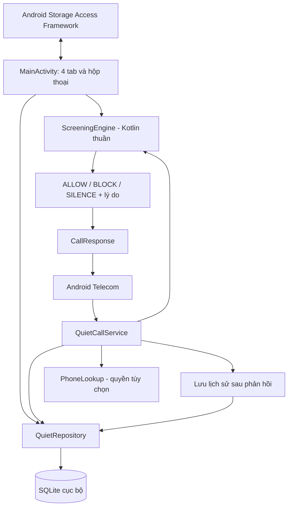

# Kiến trúc QuietCall

## Sơ đồ

## Ranh giới trách nhiệm

- `domain/ScreeningEngine.kt`: Model, chuẩn hóa số và ra quyết định. Không import Android, không I/O. Nhận snapshot; trả hành động và lý do. Mô phỏng và dịch vụ dùng chung.
- `data/QuietRepository.kt`: SQLite, CRUD, preferences, history, import/export. Context application để không giữ Activity.
- `screening/QuietCallService.kt`: Adapter Telecom, timeout, lookup contact, phản hồi hệ thống; ghi event sau response.
- `screening/Contacts.kt`: Lookup bằng ContentResolver; không đọc hay lưu toàn bộ danh bạ.
- `data/HistoryUpdates.kt`: Thông báo thay đổi trong cùng process trên main thread; Activity đăng ký theo lifecycle để cập nhật Tổng quan/Lịch sử khi cuộc gọi bị xử lý. Không mở broadcast receiver ra ứng dụng khác.
- `MainActivity.kt`: UI native, form validation, xin vai trò và quyền, chọn tài liệu, mô phỏng và hiển thị.

Đây là ứng dụng nhỏ, không có backend. Không thêm DI/ORM/navigation library để giảm phụ thuộc; SQLite và Activity phù hợp MVP. Có thể tách từng màn hình thành controller/ViewModel khi quy mô tăng.

## Quyết định kỹ thuật

**ADR-01: Android native.** Đề chấp nhận Android-only; chức năng phụ thuộc hệ điều hành. Kotlin gọi trực tiếp service, giảm rủi ro bridge. Android Views không cần thư viện UI ngoài để build. Không tuyên bố code hiện tại chạy iOS.

**ADR-02: Tra cứu bằng catalog.** Quan hệ 1 thương hiệu–N số; mỗi số thuộc tối đa một thương hiệu để lý do chặn rõ ràng. Tên tìm không dấu; chuẩn hóa mã nước Việt Nam. Không có wildcard/prefix chặn nhầm.

**ADR-03: Offline.** Không permission INTERNET, không SDK analytics. `snapshotForNumber` dùng một câu SQL tra số bằng primary key và join đúng thương hiệu/ngoại lệ, đọc preferences trong cùng statement. Không tải cả catalog cho mỗi cuộc gọi. Chỉ lookup contact khi số thuộc nhóm chặn và cần xét ngoại lệ. SQLite dùng WAL để đọc dữ liệu đã commit trong khi có writer.

**ADR-04: Fail open.** Incoming callback được xử lý ở worker; Handler chính đặt timeout 3.500 ms. AtomicBoolean đảm bảo một response; timeout hoặc lỗi cho phép. Không gọi mạng. Timeout không tạo lịch sử chặn giả.

**ADR-05: History riêng.** Không xin READ_CALL_LOG. Lưu incoming call được chuyển tới service, tối đa 500 lượt hệ thống; mô phỏng có giới hạn riêng 100 lượt. Không thay thế call log toàn hệ thống. Outgoing không bị lọc. Giữ system call log khi chặn; chỉ yêu cầu bỏ missed notification để user vẫn kiểm tra được. UI query/filter/render 25 dòng mỗi trang, không tạo 500 cards cùng lúc.

**ADR-06: Import an toàn.** Catalog schemaVersion=1, max 1 MB, max 500 brands/import, 1.000 số sau khi gộp mỗi thương hiệu, 5.000 allowed/import. Preview kiểm tra số mới/trùng/xung đột và ảnh hưởng tới nhóm đang bật chặn trước commit. Một transaction gộp mọi thay đổi; lỗi trùng số khác thương hiệu thì rollback toàn bộ. Thương hiệu mới `blocked=false`; giữ trạng thái và ghi chú của thương hiệu hiện có. Whitelist chỉ được khôi phục khi user chọn rõ; không tự tin cậy cờ blocked của tệp ngoài. Preview/import/export chạy worker, dùng helper riêng đóng bằng use; Activity helper đóng theo lifecycle.

## Schema

| Bảng | Cột / quy tắc |
|---|---|
| brands | id, name, name_key UNIQUE, note, blocked, updated_at |
| numbers | number PRIMARY KEY, brand_id FK ON DELETE CASCADE |
| allowed | number PRIMARY KEY |
| settings | key PRIMARY KEY, value boolean integer |
| events | id, number, action, reason, brand nullable, created_at epoch ms, simulated |

Database schema version 2 (khác với catalog JSON schemaVersion=1). Migration từ v1 thêm updated_at và index events(simulated,id DESC), giữ nguyên danh mục/quy tắc/whitelist; chỉ giữ 100 mô phỏng gần nhất theo giới hạn mới. Ngày cập nhật cũ chưa được ghi có giá trị 0. Mọi chỉnh sửa/nhập mới ghi thời gian cục bộ, không khẳng định nguồn đã được xác minh.

## Thứ tự bộ quyết định

1. Protection tắt → ALLOW.
2. Không có số để đối chiếu → ALLOW.
3. Số có trong whitelist → ALLOW.
4. Số có trong danh bạ và protectContacts bật → ALLOW.
5. Số khớp một thương hiệu đang chặn → SILENCE nếu bật silence, ngược lại BLOCK.
6. `matchCallerName` bật và tên hiển thị chứa `name_key` (độ dài ≥ 3) của thương hiệu đang chặn → BLOCK/SILENCE, `learnBrandId` để thêm số vào nhóm, rồi noti undo (Cho phép / Gỡ) nếu `notifyBlocked`.
7. Mọi trường hợp khác → ALLOW.

Chặn: `disallow=true`, `reject=true`, `skipNotification=true` (bỏ missed-call hệ thống), `skipCallLog=false`. Tắt chuông: `silence=true`, không disallow. Noti QuietCall là kênh riêng. Không dùng overlay/accessibility.

## Quyền

`BIND_SCREENING_SERVICE` bảo vệ service: chỉ hệ thống được bind. `ROLE_CALL_SCREENING` phải do user đồng ý. `READ_CONTACTS` runtime tùy chọn; `POST_NOTIFICATIONS` (API 33+) cho thông báo khi chặn. Manifest không xin Internet, call log, SMS, overlay hay quyền chạy foreground service.

## Nguồn API

[CallScreeningService](https://developer.android.com/reference/android/telecom/CallScreeningService), [Screen calls](https://developer.android.com/develop/connectivity/telecom/dialer-app/screen-calls), [RoleManager](https://developer.android.com/reference/android/app/role/RoleManager).
